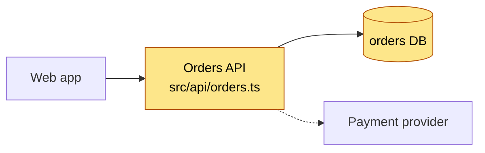

# <Topic> — Research Brief

> Researched YYYY-MM-DD · Covered: <sources used> · Not covered: <sources unavailable or skipped>

## 1. Summary

- **Bottom line:** <the single most important thing for this request>
- **It touches:** <the parts of the system involved>
- **Watch out:** <the biggest constraint, conflict, or surprise, if any>
- **Needs a human:** <what only your human partner can decide>

## 2. System Overview

Highlighted = touched by this request. Dashed = not verified.

## 3. Findings

- <fact> [E1]
- <fact> [E2][E3]

## 4. Constraints and Conflicts

- <what the design must respect, or what changes the request> [E4]

## 5. Evidence

| ID | Source | Supports | Retrieved |
|----|--------|----------|-----------|
| E1 | [Library X 4.2: Auth guide](https://…) | "Sessions expire after 24h unless refreshed." | YYYY-MM-DD |
| E2 | [orders.ts:42](src/api/orders.ts#L42) | Orders are written without a transaction | YYYY-MM-DD |
| E3 | Query (read-only): `SELECT status, COUNT(*) …` | 12% of rows have `status` NULL | YYYY-MM-DD |
| E4 | Logs, service `api`, last 7 days, filter `level=error` | 340 timeouts, all on `/orders` | YYYY-MM-DD |

## 6. Open Questions

- <what only your human partner can answer>
