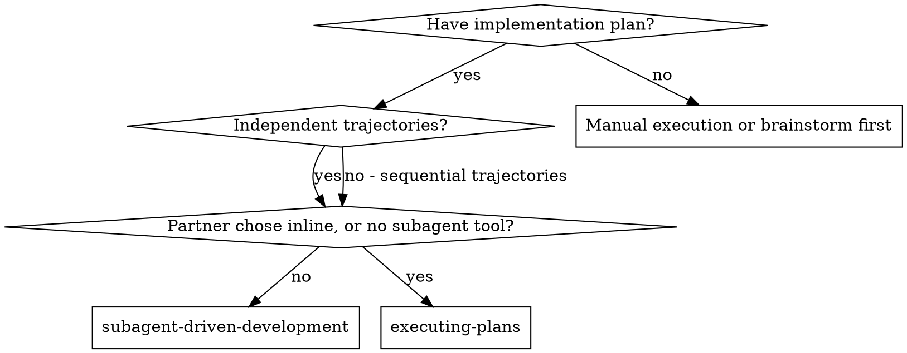
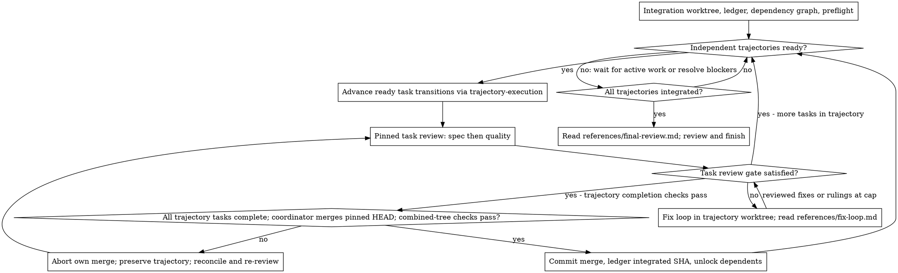

# Subagent-Driven Development

Coordinate the plan's trajectory graph. A trajectory contains one or more
tasks in one branch/worktree, ending at a clean integration boundary.
Advance independent ready trajectories concurrently, using a fresh
implementer and separate reviewer per task. The coordinator alone
integrates completed trajectories and verifies the combined tree.
Keep the broad whole-branch review at the end.

**Why subagents:** You delegate tasks to specialized agents with isolated context. By precisely crafting their instructions and context, you ensure they stay focused and succeed at their task. They should never inherit your session's context or history — you construct exactly what they need. This also preserves your own context for coordination work.

**Core principle:** Parallel trajectories containing reviewed tasks +
serialized verified trajectory merges + broad final review.

**Narration:** between tool calls, narrate at most one short line — the
ledger and the tool results carry the record.

**Continuous execution:** Do not pause to check in with your human partner between tasks. Execute all tasks from the plan without stopping. The only reasons to stop are the four named below, or all tasks complete. "Should I continue?" prompts and progress summaries waste their time — they asked you to execute the plan, so execute it.

**Rulings, not stalls.** A running plan does not wait on a human. Conflicts,
ambiguities, plan defects, a cap you would have asked to exceed — decide
them. The spec is the binding authority, the plan is its argument, and your
judgment settles what neither answers. Record every decision in the ledger as
`Ruling: <what you decided> — <why> — <what it costs if wrong>`, and keep
going. A wrong ruling costs rework your human partner can see and undo; a
session parked on a question costs their whole day and buys nothing.

Four things stop you, and only these: an irreversible or destructive
operation; a security-sensitive action; a side effect outside this worktree
that norms say you ask about first (a merge, a push to a shared branch, a
publish); and a plan so broken that every path forward is a guess. For those,
stop and ask.

Approval of a plan that explicitly authorizes local trajectory merges into
its dedicated integration branch covers those merges. Without that
authorization, ask once before integration. It never authorizes a push or
a merge into a shared target branch.

## When to Use

**vs. Executing Plans (inline):**
- Fresh subagent per task (no context pollution) instead of one context doing every task
- Review after each task (spec compliance + code quality) instead of only at the end
- Costs a fresh context per task and per review; inline costs one context plus one final reviewer
- Both run in this session and use a plan workspace and ledger. SDD
  trajectories have separate worktrees; their sequential task workers share
  that trajectory checkout. Only the coordinator updates the shared ledger.

## The Process

## Setup

Ensure the work happens in an isolated workspace: use
superpowers:using-git-worktrees to create one or verify the existing one.
Never start implementation on a main/master branch without your human
partner's explicit consent.

Conversation memory does not survive compaction. In real sessions,
controllers that lost their place have re-dispatched entire completed task
sequences — the single most expensive failure observed. Track progress in
a ledger file, not only in todos.

- Each plan owns a workspace: at skill start, run this skill's
  `bash scripts/sdd-workspace PLAN_FILE` — it prints the plan's git-ignored
  directory (under `<repo-root>/.superpowers/sdd/`), home to
  every artifact for THIS plan: ledger, briefs, reports, review packages.
  Another plan's directory is never yours to read or write.
- Check for this plan's ledger at `<workspace>/progress.md`. If one exists,
  read [references/resuming.md](references/resuming.md) before anything
  else: it says whose ledger it is and where to resume.
- Create the ledger with its identity as the first line:
  `# SDD ledger — plan: <plan file path>`.
- The ledger is your recovery map: the commits it names exist in git even
  when your context no longer remembers creating them. After compaction,
  trust the ledger and `git log` over your own recollection.
- `git clean -fdx` will destroy the workspace (it's git-ignored scratch); if
  that happens, recover from `git log`.

Read the plan once, note its context and Global Constraints, and create a
todo per task plus trajectory state in the ledger. Record both dependency
graphs and each task's unique owning trajectory. If the plan names a Spec,
read that too: the spec is the authority the plan argues from, and conflicts inside the plan resolve
against it. A plan with no reachable spec gets a ledger note saying so —
rulings made without one are provisional.

Before dispatching Task 1, read [references/preflight.md](references/preflight.md)
and run the conflict scan it describes. Its table and rulings go in the
ledger.

## Parallel Trajectories and Integration

Read [references/parallel-integration.md](references/parallel-integration.md)
before dispatch, every merge/retry, recovery, or cleanup; re-read it after
compaction. It defines metadata, pinned reviews, helper context, and merge gates.

Independent ready trajectories need unique branches/worktrees and isolated
or serialized resources. Tasks inside one trajectory share its worktree,
with one writer at a time and task review between dependent tasks. The
coordinator alone writes the ledger and merges completed pinned trajectories
serially. Task DONE starts review; task completion releases internal tasks;
external dependents wait for verified trajectory merge commits.
Preserve dirty/unmerged work.

## Plan Coordination

**REQUIRED SUB-SKILL:** Use superpowers:trajectory-execution directly in
this coordinator context to advance each trajectory's task loop. Do not
dispatch a trajectory-coordinator agent.

For each ready trajectory, create its unique branch/worktree from the
verified integration tip containing its prerequisites. Record its immutable
dispatch BASE, task membership, ownership, completion boundary, resource
assignments and check commands. Within it, task review BASE is captured
anew at each dispatch, not copied from trajectory BASE.

Schedule next transitions, not whole blocking trajectory loops: dispatch
ready task implementers across independent trajectories concurrently,
process reports/reviews as they arrive, and return to other ready work
after each dispatch or state update. A trajectory in a fix loop does not
block unrelated trajectories. Respect runtime capacity and resource locks.
Never dispatch a second writer into the same trajectory, or advance its
next task while the previous task review remains open.

When trajectory-execution reports a clean frozen trajectory ready, run its
serialized integration gate. Only a verified merge commit marks a trajectory
integrated and releases its external dependents. Task completions remain
local progress; never merge a task just because its review passed.

### Revising a Trajectory Boundary

The plan supplies initial boundaries; the coordinator may find a cleaner
cut during execution. At a reviewed task boundary with no active agents or
processes in that trajectory:

1. Establish that the completed scope is independently usable, its public
   contracts are complete, and its checks prove the new completion boundary.
2. Record `Ruling: <boundary change> — <why> — <cost if wrong>`, the revised
   scope/checks, and stable successor IDs in the plan workspace. Move each
   pending task exactly once; retain global task IDs and completion history.
3. Rewire actual prerequisite edges and ownership/interfaces; check both
   graphs for cycles and lost requirements. Consumers needing pending work
   depend on its successor, not merely the shortened trajectory.
4. Complete and integrate the revised trajectory through the normal gates.
   Create successors from verified integration only after their prerequisites
   pass. A clean candidate cut is not an early task merge.

Never split an active task or mutate a branch under review. Record boundary
amendments beside the ledger and pass the revised task contracts in briefs;
the original plan plus its recorded amendments remain the requirements source.

## Model Selection

Use the least powerful model that can handle each role to conserve cost and increase speed.

**Mechanical implementation tasks** (isolated functions, clear specs, 1-2 files): use a fast, cheap model. Most implementation tasks are mechanical when the plan is well-specified.

**Integration and judgment tasks** (multi-file coordination, pattern matching, debugging): use a standard model.

**Architecture and design tasks**: use the most capable available model.
The final whole-branch review is one of these — dispatch it on the most
capable available model, not the session default.

**Review tasks**: choose the model with the same judgment, scaled to the
diff's size, complexity, and risk. A small mechanical diff does not need the
most capable model; a subtle concurrency change does. Scoped re-reviews of
small fix diffs take a cheap-to-mid tier.

**Fix-loop escalation (rounds 4-5)**: use a model at least one tier above
the implementer that got stuck.

**Always specify the model explicitly when dispatching a subagent.** An
omitted model inherits your session's model — often the most capable and
most expensive — which silently defeats this section.

**Turn count beats token price.** Wall-clock and context cost scale with how
many turns a subagent takes, and the cheapest models routinely take 2-3× the
turns on multi-step work — costing more overall. Use a mid-tier model as the
floor for reviewers and for implementers working from prose descriptions.
When the task's plan text contains the complete code to write, the
implementation is transcription plus testing: use the cheapest tier for
that implementer. Single-file mechanical fixes also take the cheapest tier.

**Task complexity signals (implementation tasks):**
- Touches 1-2 files with a complete spec → cheap model
- Touches multiple files with integration concerns → standard model
- Requires design judgment or broad codebase understanding → most capable model

## The Task Loop

Follow superpowers:trajectory-execution for the next task transition.
The existing implementer/reviewer templates and fix-loop references remain
the role contracts. Never accept a task review without both spec and
quality verdicts, replace it with self-review, or pre-judge findings in a
review dispatch. Copy binding Global Constraints verbatim into task reviews.

Name each task's report after its brief (`task-N-brief.md` ->
`task-N-report.md`) and record its implementer's agent identity for fix
resumes. Keep detailed reports and review packages in files, not accumulated
dispatch histories. Each worker gets its task, relevant interfaces, rulings
and constraints, not the session history.

Wait using the harness's completion notifications. While agents run,
update the ledger and package ready reviews. When genuinely idle, use a
bounded wait supported by the platform; do not poll with short timeouts
or block independent ready work.

## Final Review

When every trajectory is integrated and verified, read
[references/final-review.md](references/final-review.md) and follow it. It
covers the whole-branch review, its single fix wave, and how you finish.

## Common Rationalizations

| Excuse | Reality |
|--------|---------|
| "Close enough on spec compliance" | Reviewer found spec gaps = not done. Fix or hit the cap and adjudicate — those are the only exits. |
| "I'll fix it myself, dispatching is overhead" | Controller fixes pollute your context and skip review. Resume the implementer. |
| "One more round will converge" | Past the cap, rounds don't converge — the failure is structural. Adjudicate and route. |
| "The reviewer will just find something new anyway" | Scoped re-reviews verify fixes; they cannot wander. New findings on untouched code go to the ledger, not the loop. |
| "This finding is obviously wrong, I'll drop it" | You adjudicate only at the cap, and every ruling is a ledger entry. Silent discards are forbidden. |
| "The fix was small, skip the re-review" | Unreviewed fixes are how regressions land. Every round ends with a scoped re-review. |
| "Reviews slow the loop down" | The loop without reviews is just unverified churn. Reviews are the loop's brakes and steering. |
| "Ledger bookkeeping is overhead" | The ledger is what survives compaction. Controllers without one have re-dispatched entire completed task sequences. |
| "The implementer spawned its own reviewer — free extra assurance" | It's a duplicate seat reviewing the same diff; the task review is the gate. A worker-spawned reviewer is a defect to flag, not rigor. |
